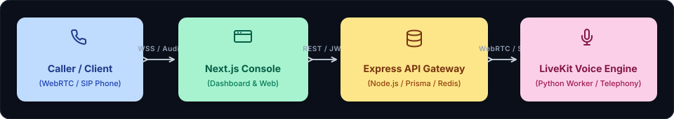

<div align="center">


<br/>

<a href="#system-architecture">
  
</a>
&nbsp;
<a href="#system-architecture">
  
</a>
&nbsp;
<a href="#system-architecture">
  
</a>
&nbsp;
<a href="#system-architecture">
  
</a>

</div>

<br/>

# QuickVoice

An open-source operating platform for building, deploying, and managing autonomous AI phone agents capable of natural, sub-second latency voice conversations over standard telephony networks.

[](https://quickvoice.co)
[](https://www.typescriptlang.org/)
[](https://www.gnu.org/licenses/agpl-3.0)
[](https://www.docker.com/)
[](https://livekit.io/)

---

## Project Overview

QuickVoice provides production-grade infrastructure for orchestrating voice-based artificial intelligence. Traditional voice bots suffer from unnatural delays and rigid decision trees. QuickVoice solves this by integrating WebRTC audio streaming, streaming speech-to-text, large language model decision engines, and expressive speech synthesis into a sub-500ms conversational loop.

**Vision:** Democratize enterprise-grade conversational AI by providing a developer-first platform that connects any LLM to real-world phone lines with full operational control.

---

## System Architecture

<p align="center" style="margin: 20px 0;">
  
</p>

* **Caller / Client (WebRTC / SIP Phone)**: Inbound telephone calls and in-browser voice sessions streaming raw Opus audio over WebRTC.
* **Next.js Console & Web**: Customer dashboard for agent prompt engineering, call analytics, and audio scrubber controls.
* **Express API Gateway**: Node.js REST and WebSocket server managing authentication, Prisma ORM, Redis queues, and webhook dispatches.
* **LiveKit Voice Engine**: High-throughput Python worker executing Silero VAD, streaming STT, clause-chunked LLM inference, and Cartesia TTS audio synthesis.

---

## Engineering Documentation

The project includes a complete production-grade architecture and development documentation suite:

| Document | Purpose |
| :-- | :-- |
| [**`docs/PRD.md`**](./docs/PRD.md) | Product Requirements Document: MVP specifications, target personas & success metrics |
| [**`docs/ARCHITECTURE.md`**](./docs/ARCHITECTURE.md) | System topology, real-time voice streaming pipeline, monorepo tree & ADRs |
| [**`docs/RULES.md`**](./docs/RULES.md) | Engineering standards, TypeScript/Python conventions, and latency thresholds |
| [**`docs/DESIGN.md`**](./docs/DESIGN.md) | Design system, UI tokens, Inter & JetBrains Mono typography, and telemetry cards |
| [**`docs/TASKS.md`**](./docs/TASKS.md) | Phased roadmap tracking 24 engineering deliverables with priority & status badges |
| [**`docs/MEMORY.md`**](./docs/MEMORY.md) | Active session memory, completed milestone log, and operational boundaries |

---

## Key Features

- **Bidirectional Telephony Integration:** Seamless connectivity with Twilio, Telnyx, and SIP trunks for inbound and outbound calling.
- **Sub-Second Audio Pipeline:** Low-latency WebRTC audio transport powered by LiveKit for interruption-friendly conversations.
- **Model Context Protocol (MCP) Integration:** Extensible tool execution allowing voice agents to query databases and trigger APIs mid-call.
- **Comprehensive Agent Dashboard:** Real-time call monitoring, latency breakdown, full audio transcripts, and sentiment tracking.
- **Multi-Tenant Architecture:** Granular workspace management with role-based access control and telephony credential isolation.
- **Self-Hostable Deployment:** Complete Docker and Docker Compose definitions for private cloud or on-premise execution.

---

## Technology Stack

| Layer | Technologies | Implementation Detail |
|---|---|---|
| **Frontend & Console** | Next.js 14, React 18, Tailwind CSS | Management dashboard, call scrubber & analytics |
| **Backend & Gateway** | Node.js, Express, TypeScript | REST API, webhook dispatch & auth |
| **Real-Time Voice Engine** | Python 3.12, LiveKit Agents SDK | WebRTC audio room controller & frame streaming |
| **Speech Intelligence** | Silero VAD, Deepgram Nova-2, Cartesia Sonic | Sub-150ms STT & sub-120ms TTS voice synthesis |
| **Data & Cache** | PostgreSQL, Prisma ORM, Redis, BullMQ | Session persistence & outbound dial queueing |
| **Telephony Integration** | Twilio Voice, Telnyx SIP Trunking | Inbound & outbound cellular voice dispatching |
| **Protocol Standards** | Model Context Protocol (MCP) | Dynamic external agent tool execution |

---

## Getting Started

### Prerequisites
- Docker Engine >= 24.0 and Docker Compose >= 2.20
- Node.js >= 20.9.0 and pnpm >= 9.0.0
- Python 3.12 (matching AI worker runtime)
- Twilio or Telnyx telephony credentials (for real calls)

### Installation

1. Clone the repository:
   ```bash
   git clone https://github.com/abhishek4643/QuickVoice.git
   cd QuickVoice
   ```

2. Configure environment variables:
   ```bash
   cp .env.dev.example .env.dev
   ```
   Populate `.env.dev` with your LiveKit, telephony, and model provider credentials.

3. Start services via Docker Compose:
   ```bash
   docker compose -f docker-compose.dev.yml up -d
   ```

4. Launch the development workspace:
   ```bash
   pnpm install
   pnpm dev
   ```

5. Access the services:
   - Console: `http://localhost:3000`
   - Marketing Site: `http://localhost:3001`
   - API Docs: `http://localhost:5000/api/v1/docs`
   - AI Worker Health: `http://localhost:5555/health`

---

## License

This project is licensed under the GNU Affero General Public License v3.0 (AGPL-3.0).
