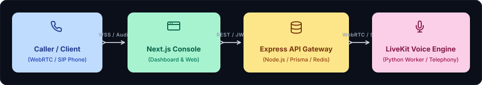

# System Architecture
### QuickVoice — Architectural Topology, Real-Time Audio Pipeline, and System Specifications

<div align="center">
  
</div>

This document describes the overall system architecture, technology stack, directory structure, real-time voice streaming pipeline, and key design decisions for the **QuickVoice** software platform.

---

### 1. High-Level Architecture

QuickVoice follows an event-driven, decoupled monorepo architecture separating web/console interfaces and database persistence from ultra-low-latency WebRTC audio workers:

<p align="center" style="margin: 20px 0;">
  
</p>

---

### 2. Technology Stack

Technologies used across the QuickVoice monorepo and their architectural purpose:

| Layer | Technology | Implementation Detail |
| :-- | :-- | :-- |
| **Monorepo Build System** | Turborepo + pnpm v9 | High-performance monorepo orchestration with frozen lockfiles and shared packages |
| **Customer Console & Web**| Next.js 14 (App Router) | Server-rendered marketing portal and client dashboard with Tailwind CSS & Lucide |
| **API Gateway & Services** | Express 4 + TypeScript | Asynchronous REST and WebSocket API coordinating auth, campaigns, and call sessions |
| **Database & ORM** | PostgreSQL + Prisma ORM | Relational schema modeling users, agents, call logs, phone numbers, and transcripts |
| **Cache & Task Queue** | Redis + BullMQ | Ephemeral session state, token rate-limiting, and outbound call campaign dispatch queues |
| **Real-Time Voice Engine** | LiveKit WebRTC SDK (Python) | Full-duplex room management, audio frame ingestion, and participant synchronization |
| **Voice Activity Detection**| Silero VAD | In-process neural voice activity detection enabling natural conversational barge-in |
| **Speech-to-Text (STT)** | Deepgram Nova-2 / Whisper | Real-time streaming transcription with sub-150ms word-level timestamp emission |
| **Language Intelligence** | OpenAI / Anthropic / Groq | Low-latency streaming token generation with dynamic function and tool calling |
| **Text-to-Speech (TTS)** | Cartesia Sonic / ElevenLabs | Ultra-low-latency 24kHz audio synthesis emitting streamable Opus chunks (<120ms TTFT) |
| **Telephony Integration** | Twilio & Telnyx SIP | SIP trunking gateway bridging cellular phone networks with LiveKit WebRTC rooms |
| **Tool Protocol** | Model Context Protocol (MCP) | Standardized MCP server exposing QuickVoice telephony tools to external AI agents |

---

### 3. Folder Structure

QuickVoice follows a clean Turborepo monorepo architecture separating frontend applications, backend services, and shared libraries:

```text
QuickVoice/
|-- apps/
|   |-- ai/                             # Python LiveKit real-time voice worker
|   |   |-- handlers/                   # Audio frame listeners, barge-in & Langfuse telemetry
|   |   |-- api.py                      # Health checks and worker status endpoints
|   |   |-- main.py                     # Entry point for LiveKit agent worker loop
|   |   `-- requirements.txt            # Locked Python voice runtime dependencies
|   |-- console/                        # Next.js customer management console
|   |   |-- src/app/                    # App Router pages (Agents, Call Logs, Analytics)
|   |   `-- package.json
|   |-- web/                            # Next.js product landing and marketing site
|   |-- server/                         # Express REST API gateway
|   |   |-- src/lib/                    # Telephony drivers (Twilio, Telnyx), Prisma client
|   |   |-- src/routes/                 # Endpoints for agents, calls, campaigns, webhooks
|   |   `-- src/index.ts                # Server startup and WebSocket listener
|   |-- widget/                         # Embeddable WebRTC client audio dialer
|   `-- mcp-server/                     # Model Context Protocol server for external agents
|-- packages/
|   |-- db/                             # Shared Prisma schema and database migrations
|   |-- config/                         # Shared ESLint, Prettier, and TypeScript configs
|   `-- ui/                             # Reusable design system components
|-- docs/                               # Engineering architecture & design specifications
|   |-- PRD.md                          # Product requirements & feature specifications
|   |-- ARCHITECTURE.md                 # System topology, data flow & tech stack
|   |-- RULES.md                        # Coding standards & low-latency guidelines
|   |-- DESIGN.md                       # Design system, UI tokens & visual palette
|   |-- TASKS.md                        # Phased task dashboard & execution tracker
|   `-- MEMORY.md                       # Session memory, active phase & decision logs
|-- docker-compose.dev.yml              # Local Postgres, Redis, and Mailpit services
|-- package.json                        # Root workspace configuration
|-- pnpm-workspace.yaml                 # Monorepo workspace definition
`-- README.md                           # Quickstart guide, setup instructions & tour
```

---

### 4. Real-Time Audio Pipeline & Conversational Loop

```text
[ Caller / Phone Network ]
         |
         v (Inbound Audio Stream via SIP / WebRTC)
  [ LiveKit Room ]
         |
         v
  [ Silero VAD ] ---> (Detects Voice / Interruption Event)
         |
         v (Audio Frames)
  [ Deepgram Nova-2 STT ] ---> (Streaming Word Transcripts)
         |
         v
  [ Streaming LLM (Groq / OpenAI) ] ---> (Token Stream & Tool Calls)
         |
         v
  [ Cartesia Sonic TTS ] ---> (Raw PCM / Opus Audio Chunks)
         |
         v
  [ LiveKit Audio Track ]
         |
         v
[ Caller Receives Audio Response (< 450ms Total Turnaround) ]
```

---

### 5. Key Architectural Decisions (ADRs)

* **ADR-001: LiveKit WebRTC Transport over Custom WebSockets**  
  *Rationale*: LiveKit handles WebRTC ICE candidate negotiation, NAT traversal, adaptive bitrate streaming, and packet loss concealment natively. Building custom audio WebSockets introduces jitter, echo cancellation issues, and scaling bottlenecks.
* **ADR-002: Modular Python AI Worker with Express API Gateway**  
  *Rationale*: Node.js/Express excels at high-concurrency REST APIs, database queries, and webhooks. Python is superior for real-time audio SDKs, PyTorch VAD models, and NumPy buffer manipulations. Separating them ensures neither blocks the other.
* **ADR-003: Sub-500ms Streaming Chunk Processing (Chunk-to-Chunk Pipeline)**  
  *Rationale*: Waiting for full sentences before triggering TTS introduces >1200ms latency. The pipeline processes tokens dynamically: as soon as the LLM yields a clause boundary (commas, periods), text chunks are streamed into Cartesia TTS, bringing response latency under 450ms.