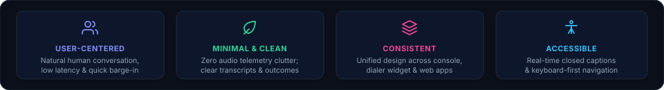
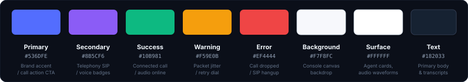

# Design System
### QuickVoice — Clean. Simple. Productive.

<div align="center">
  
</div>

This document defines the visual design system, UI components, design tokens, and user experience standards for the **QuickVoice** customer console, dialer widget, and administrative dashboards. The goal is to establish a modern, minimal, developer-friendly interface with consistent styling across web applications, telephony dashboards, and telemetry monitors.

---

### 1. Design Principles

<p align="center" style="margin: 20px 0;">
  
</p>

---

### 2. Color Palette
*Primary colors used across the console, dialer widget, and real-time audio monitors:*

<p align="center" style="margin: 20px 0;">
  
</p>

---

### 3. Typography
*We use Inter as the primary interface font and JetBrains Mono for audio telemetry, latency stats, and transcripts:*

<div style="background-color: #0D1117; border: 1px solid #30363D; border-radius: 8px; padding: 18px 20px; margin: 14px 0;">
  <table width="100%" cellpadding="0" cellspacing="0" border="0">
    <tr>
      <td width="90" align="center" style="font-size: 40px; font-weight: 800; background-color: #161B22; color: #818CF8; border: 1px solid #30363D; border-radius: 8px; padding: 8px 12px;">Aa</td>
      <td style="padding-left: 20px;">
        <div style="font-size: 18px; font-weight: 700; color: #F0F6FC;">Inter &amp; JetBrains Mono</div>
        <div style="color: #818CF8; font-size: 12px; font-weight: 600; margin-top: 2px;">Primary font family</div>
        <div style="color: #8B949E; font-size: 12px; margin-top: 4px;">Clean, modern, and highly legible across live call transcripts, latency telemetry, and configuration tables.</div>
      </td>
    </tr>
  </table>
</div>

| Element | Font Family | Size | Weight | Line Height |
| :-- | :-- | :-: | :-: | :-: |
| **Heading 1 (H1)** | Inter | 24px (1.5rem) | 700 Bold | 1.3 |
| **Heading 2 (H2)** | Inter | 18px (1.125rem) | 600 Semi-Bold | 1.4 |
| **Heading 3 (H3)** | Inter | 14px (0.875rem) | 600 Semi-Bold | 1.4 |
| **Body Text** | Inter | 13px (0.8125rem) | 400 Regular | 1.6 |
| **Transcripts & Telemetry** | JetBrains Mono | 12px (0.75rem) | 400 Regular / 600 Bold | 1.6 |
| **Status Badges & Pills** | Inter | 11px (0.6875rem) | 600 Semi-Bold | 1.2 |

---

### 4. UI Components
*Standard components matching Abhishek's profile design standards:*

#### Buttons
<div style="margin: 12px 0;">
  <a href="#" style="background-color: #4F46E5; color: #FFFFFF; border-radius: 6px; padding: 8px 18px; font-size: 12px; font-weight: 600; text-decoration: none; display: inline-block; margin-right: 8px;">Start Voice Call</a>
  <a href="#" style="background-color: #161B22; color: #C9D1D9; border: 1px solid #30363D; border-radius: 6px; padding: 8px 18px; font-size: 12px; font-weight: 600; text-decoration: none; display: inline-block; margin-right: 8px;">View Transcripts</a>
  <a href="#" style="background-color: #EA4335; color: #FFFFFF; border-radius: 6px; padding: 8px 18px; font-size: 12px; font-weight: 600; text-decoration: none; display: inline-block;">Hang Up Call</a>
</div>

#### Status Badges (Shields & Pills)
<div style="margin: 12px 0;">
  
  &nbsp;
  
  &nbsp;
  
  &nbsp;
  
</div>

#### Live Call Telemetry Card
```text
+---------------------------------------------------------------------------------+
|  QuickVoice Real-Time Audio Telemetry                          [ CONNECTED ]    |
+---------------------------------------------------------------------------------+
|  Session ID: call_live_7f8a91b2c4                                               |
|  Caller: +1 (555) 349-2041            Duration: 02m 45s                         |
|  Audio Codec: Opus / 24kHz            Jitter Buffer: 18ms                       |
|  Time-to-First-Token (TTFT): 342ms    Roundtrip Latency: 410ms                  |
|                                                                                 |
|  >>> Real-Time Streaming Transcript:                                            |
|  Caller [02:38]: "Can you reschedule my appointment to Thursday at 2 PM?"       |
|  Agent  [02:40]: "Certainly! I have rescheduled your appointment for           |
|                  Thursday, November 5th at 2:00 PM. A confirmation              |
|                  SMS has been dispatched to your mobile number."                |
|                                                                                 |
|  >>> Telephony Event Pipeline:                                                  |
|  [OK] Silero VAD Speech Segment Detected                                        |
|  [OK] Deepgram Nova-2 Transcript Emitted (confidence: 0.98)                     |
|  [OK] LLM Streaming Tool Call: calendar_reschedule(time='2026-11-05T14:00:00')  |
|  [OK] Cartesia Sonic Audio Synthesized & Ingested into LiveKit Track            |
+---------------------------------------------------------------------------------+
```
